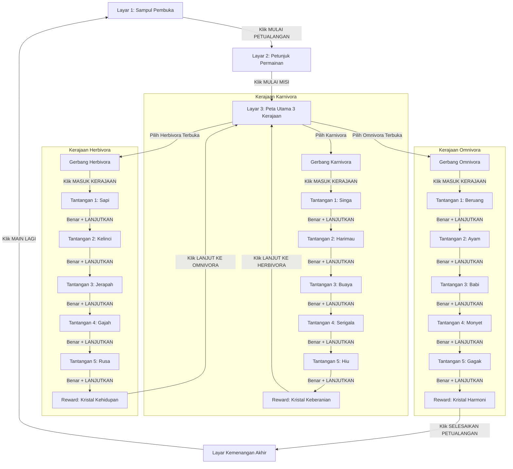

# Spesifikasi Desain: Petualangan Mini Zoo (Google Apps Script Web App)

**Tanggal:** 2026-11-06  
**Status:** Draf Tinjauan  
**Dokumen Acuan:** `NASKAH ALUR PERMAINAN.docx`  
**Target Pengguna:** Siswa Kelas 4 Sekolah Dasar  
**Platform Target:** Google Apps Script Web App & Browser Standalone  

---

## 1. Misi & Tujuan (Intent & The Why)

Game "Petualangan Mini Zoo" dirancang sebagai media edukasi interaktif untuk siswa kelas 4 SD agar dapat memahami klasifikasi hewan berdasarkan jenis makanannya secara seru, kontekstual, dan bermakna.

### Tujuan Pembelajaran
1. Siswa mampu membedakan 3 kategori satwa:
   - **Karnivora:** Hewan pemakan daging / hewan lain.
   - **Herbivora:** Hewan pemakan tumbuhan (rumput, daun, buah, biji).
   - **Omnivora:** Hewan pemakan segala (campuran daging/hewan kecil dan tumbuhan).
2. Siswa mampu mengidentifikasi ciri-ciri fisik dan kebiasaan 15 satwa nyata melalui petunjuk bertahap.
3. Siswa termotivasi menyelesaikan 15 tantangan untuk memperoleh 3 Kristal Kerajaan dan meraih gelar agung: **"PENJAGA PENGETAHUAN SATWA MINI ZOO"**.

---

## 2. Sasaran, Batasan, dan Anti-Goals

### Goals (Sasaran Utama)
- **Kesesuaian 100% Naskah:** Semua narasi, dialog Survivor, petunjuk hewan, opsi jawaban, kunci jawaban, dan materi edukatif mengikuti teks verbatim pada `NASKAH ALUR PERMAINAN.docx`.
- **Ekosistem Google Apps Script:** Dapat dijalankan secara mulus di Google Apps Script (`script.google.com`) baik dalam mode multi-file (`Index`, `Stylesheet`, `JavaScript`, `GameData`, `Code.gs`) maupun mode file tunggal mandiri (`index.html`).
- **Antarmuka Taktil & Ramah Anak (Claymorphism Safari):** Menggunakan estetika petualangan safari dengan rasio 16:9, sudut membulat ramah anak, kontras tinggi (WCAG AAA), dan tombol 3D taktil yang stabil tanpa getar (*zero jitter*).
- **Logika State Machine Ketat (Tabel J2):** Progres mini map 5-titik dikendalikan oleh logika game dinamis, bukan sekadar pergantian gambar statis.
- **Audio Sintesis Mandiri:** Menggunakan Web Audio API terintegrasi untuk suara klik kayu, petikan kristal, nada benar (chime C-E-G), dan peringatan salah (thud), tanpa ketergantungan file MP3 eksternal yang rawan blokir CORS di Apps Script.

### Non-Goals
- Tidak memerlukan login akun Google khusus bagi siswa (dapat diakses siapa saja sebagai Web App publik).
- Tidak menggunakan database eksternal yang rumit; progres sesi tersimpan secara lokal (*in-memory* dan `localStorage`).

### Anti-Goals (Hal yang Dilarang Keras)
- **Dilarang keras ada tombol loncat/bergetar (*button jitter*):** Tombol yang diposisikan di tengah (`translateX(-50%)`) tidak boleh kehilangan nilai sumbu X pada status `:hover` atau `:active` yang menyebabkan kursor lepas dan klik batal.
- **Dilarang menggunakan emoji generik pada teks antarmuka (*antislop*):** Seluruh ikon menggunakan SVG vektor atau simbol tipografi formal (seperti `▶` atau emblem SVG), bukan emoji sistem operasi.
- **Dilarang melompati tantangan secara ilegal:** Pemain tidak boleh membuka Kerajaan Herbivora sebelum Karnivora tuntas (5/5), dan tidak boleh membuka Omnivora sebelum Herbivora tuntas (5/5).
- **Dilarang menambah progres saat jawaban salah:** Progres checkpoint hanya bertambah setelah pemain menjawab benar dan menekan tombol `LANJUTKAN`.

---

## 3. Struktur Alur Permainan (Game Flow Architecture)

Alur permainan mengacu pada Bagian B dan J3 naskah:



---

## 4. Rincian Data Konten (15 Satwa Berdasarkan Naskah)

### Kerajaan 1: Karnivora (Emblem Cakar, Reward: Kristal Keberanian / Carnivore Ruby)
1. **Level 1 — Singa**
   - *Petunjuk:* "Aku pemakan daging. Aku memiliki surai lebat di sekitar kepala dan leher."
   - *Pertanyaan:* "Siapakah aku?"
   - *Pilihan:* A. Harimau | B. Singa | C. Serigala
   - *Kunci:* B. Singa
   - *Edukasi:* "Aku adalah singa. Aku termasuk hewan karnivora karena memakan daging. Surai lebat di sekitar kepala dan leher merupakan salah satu ciri khas singa jantan."
2. **Level 2 — Harimau**
   - *Petunjuk:* "Aku pemakan daging. Tubuhku memiliki belang hitam dan oranye."
   - *Pertanyaan:* "Siapakah aku?"
   - *Pilihan:* A. Harimau | B. Kelinci | C. Kambing
   - *Kunci:* A. Harimau
   - *Edukasi:* "Aku adalah harimau. Aku termasuk hewan karnivora karena memakan daging. Belang pada tubuhku menjadi salah satu ciri khas yang mudah dikenali."
3. **Level 3 — Buaya**
   - *Petunjuk:* "Aku pemakan daging. Aku hidup di air dan darat serta memiliki rahang kuat dan gigi tajam."
   - *Pertanyaan:* "Siapakah aku?"
   - *Pilihan:* A. Kura-kura | B. Buaya | C. Katak
   - *Kunci:* B. Buaya
   - *Edukasi:* "Aku adalah buaya. Aku termasuk hewan karnivora karena memakan hewan lain. Rahangku kuat dan gigi tajam membantuku menangkap mangsa."
4. **Level 4 — Serigala**
   - *Petunjuk:* "Aku pemakan daging. Aku sering hidup berkelompok dan berkomunikasi dengan lolongan."
   - *Pertanyaan:* "Siapakah aku?"
   - *Pilihan:* A. Rubah | B. Anjing | C. Serigala
   - *Kunci:* C. Serigala
   - *Edukasi:* "Aku adalah serigala. Aku termasuk hewan karnivora. Aku sering hidup dalam kelompok dan menggunakan lolongan untuk berkomunikasi."
5. **Level 5 — Hiu**
   - *Petunjuk:* "Aku pemakan daging. Aku ikan laut yang bernapas dengan insang dan memiliki banyak gigi tajam."
   - *Pertanyaan:* "Siapakah aku?"
   - *Pilihan:* A. Paus | B. Hiu | C. Lumba-lumba
   - *Kunci:* B. Hiu
   - *Edukasi:* "Aku adalah hiu. Aku termasuk hewan karnivora karena memakan hewan laut lain. Aku bernapas menggunakan insang dan memiliki banyak gigi."

---

### Kerajaan 2: Herbivora (Emblem Daun, Reward: Kristal Kehidupan / Herbivore Emerald)
1. **Level 1 — Sapi**
   - *Petunjuk:* "Aku pemakan tumbuhan. Aku menghasilkan susu dan bersuara muuu."
   - *Pertanyaan:* "Siapakah aku?"
   - *Pilihan:* A. Kambing | B. Sapi | C. Kuda
   - *Kunci:* B. Sapi
   - *Edukasi:* "Aku adalah sapi. Aku termasuk hewan herbivora karena memakan tumbuhan seperti rumput. Susuku juga dapat diolah menjadi berbagai produk makanan."
2. **Level 2 — Kelinci**
   - *Petunjuk:* "Aku pemakan tumbuhan. Telingaku panjang dan aku suka melompat."
   - *Pertanyaan:* "Siapakah aku?"
   - *Pilihan:* A. Kelinci | B. Kambing | C. Rusa
   - *Kunci:* A. Kelinci
   - *Edukasi:* "Aku adalah kelinci. Aku termasuk hewan herbivora karena memakan tumbuhan seperti rumput dan berbagai jenis sayuran."
3. **Level 3 — Jerapah**
   - *Petunjuk:* "Aku pemakan tumbuhan. Leherku sangat panjang untuk menjangkau daun tinggi."
   - *Pertanyaan:* "Siapakah aku?"
   - *Pilihan:* A. Zebra | B. Jerapah | C. Kuda
   - *Kunci:* B. Jerapah
   - *Edukasi:* "Aku adalah jerapah. Aku termasuk hewan herbivora karena memakan tumbuhan. Leherku yang panjang membantuku menjangkau daun di pohon yang tinggi."
4. **Level 4 — Gajah**
   - *Petunjuk:* "Aku pemakan tumbuhan. Tubuhku besar dan aku memiliki belalai panjang."
   - *Pertanyaan:* "Siapakah aku?"
   - *Pilihan:* A. Kuda | B. Gajah | C. Rusa
   - *Kunci:* B. Gajah
   - *Edukasi:* "Aku adalah gajah. Aku termasuk hewan herbivora karena memakan tumbuhan. Belalaiku membantuku mengambil makanan dan minum."
5. **Level 5 — Rusa**
   - *Petunjuk:* "Aku pemakan tumbuhan. Aku lincah dan rusa jantan memiliki tanduk bercabang."
   - *Pertanyaan:* "Siapakah aku?"
   - *Pilihan:* A. Sapi | B. Rusa | C. Kelinci
   - *Kunci:* B. Rusa
   - *Edukasi:* "Aku adalah rusa. Aku termasuk hewan herbivora karena memakan tumbuhan seperti rumput, daun, dan tunas."

---

### Kerajaan 3: Omnivora (Emblem Campuran, Reward: Kristal Harmoni / Omnivore Amethyst)
1. **Level 1 — Beruang**
   - *Petunjuk:* "Aku pemakan segalanya. Aku suka ikan dan juga madu manis."
   - *Pertanyaan:* "Siapakah aku?"
   - *Pilihan:* A. Beruang | B. Serigala | C. Kucing
   - *Kunci:* A. Beruang
   - *Edukasi:* "Aku adalah beruang. Aku termasuk hewan omnivora karena dapat memakan berbagai jenis makanan, baik tumbuhan maupun hewan."
2. **Level 2 — Ayam**
   - *Petunjuk:* "Aku pemakan segalanya. Aku memakan biji-bijian dan juga cacing tanah."
   - *Pertanyaan:* "Siapakah aku?"
   - *Pilihan:* A. Bebek | B. Ayam | C. Angsa
   - *Kunci:* B. Ayam
   - *Edukasi:* "Aku adalah ayam. Aku termasuk hewan omnivora karena memakan biji-bijian serta hewan kecil seperti cacing dan serangga."
3. **Level 3 — Babi**
   - *Petunjuk:* "Aku pemakan segalanya. Hidungku bulat dan aku memakan umbi serta sisa makanan."
   - *Pertanyaan:* "Siapakah aku?"
   - *Pilihan:* A. Kuda | B. Kambing | C. Babi
   - *Kunci:* C. Babi
   - *Edukasi:* "Aku adalah babi. Aku termasuk hewan omnivora karena dapat memakan berbagai jenis makanan, seperti tumbuhan dan hewan kecil."
4. **Level 4 — Monyet**
   - *Petunjuk:* "Aku pemakan segalanya. Aku suka buah, biji, dan serangga kecil di pohon."
   - *Pertanyaan:* "Siapakah aku?"
   - *Pilihan:* A. Monyet | B. Kelinci | C. Rusa
   - *Kunci:* A. Monyet
   - *Edukasi:* "Aku adalah monyet. Aku termasuk hewan omnivora karena dapat memakan buah, biji-bijian, dan beberapa jenis hewan kecil."
5. **Level 5 — Gagak**
   - *Petunjuk:* "Aku pemakan segalanya. Buluku hitam dan aku memakan biji, buah, serta bangkai hewan."
   - *Pertanyaan:* "Siapakah aku?"
   - *Pilihan:* A. Elang | B. Gagak | C. Merpati
   - *Kunci:* B. Gagak
   - *Edukasi:* "Aku adalah gagak. Aku termasuk hewan omnivora karena dapat memakan berbagai jenis makanan, seperti biji-bijian, buah, serangga, dan hewan kecil."

---

## 5. Sistem Antarmuka & Desain Visual (UI/UX Pro Max & Antislop)

1. **Rasio Tampilan Kanvas 16:9:**
   - Kanvas berukuran proporsional `max-width: 1140px; aspect-ratio: 16 / 9;`.
   - Menggunakan teknik *containment & responsive fit* agar nyaman dimainkan di proyektor kelas, laptop, maupun tablet siswa.
2. **Palet Warna Safari Petualangan:**
   - *Latar Belakang Utama:* Deep Safari Forest `#0B2312` ke `#1B4323`.
   - *Aksen Kayu Taktil:* Warm Saddle Wood `#78350F`, Rich Timber `#451A03`, Gold Outline `#F59E0B`.
   - *Karnivora (Api & Semangat):* Crimson `#DC2626` dan Sun Amber `#F97316`.
   - *Herbivora (Alam & Kesuburan):* Emerald `#16A34A` dan Leaf Green `#4ADE80`.
   - *Omnivora (Misteri & Harmoni):* Royal Purple `#7C3AED` dan Vivid Violet `#A855F7`.
3. **Prinsip Tombol & Interaksi Antarmuka:**
   - Semua tombol utama berdesain 3D Claymorphism dengan bayangan kedalaman berlapis (`box-shadow: 0 6px 0 ...`).
   - Efek `:active` hanya menekan ke bawah (`translateY(3px)` dengan reduksi bayangan `0 2px 0`).
   - **Zero Jitter:** Pada elemen dengan penataan tengah (`left: 50%`), properti `transform` wajib menyertakan `translateX(-50%)` pada `:hover` dan `:active`.
   - Label teks dan ikon di dalam tombol memiliki `pointer-events: none` agar klik selalu diteruskan langsung ke elemen `<button>`.

---

## 6. Arsitektur Teknis Google Apps Script

```
proyek/
├── src/
│   ├── Code.gs             <- Entry point Web App (doGet & include helper)
│   ├── Index.html          <- Kerangka HTML SPA 16:9 & struktur layar
│   ├── Stylesheet.html     <- Sistem CSS lengkap responsif & tema 3 kerajaan
│   ├── JavaScript.html     <- Mesin logika (Router, MiniMap, Quiz, Sound)
│   └── GameData.html       <- Data 15 satwa, 3 kerajaan, dan narasi verbatim
├── index.html              <- Bundle tunggal siap pakai (kompilasi src)
└── docs/
    └── superpowers/specs/  <- Dokumentasi desain dan perencanaan
```

---

## 7. Rencana Verifikasi Kualitas
1. **Verifikasi Teks Naskah:** Pemeriksaan verbatim 15 soal, petunjuk, opsi, dan penjelasan edukasi.
2. **Uji Klik Headless Chrome:** Pengujian simulasi klik mouse nyata pada setiap tombol transisi layar (termasuk verifikasi tidak ada loncatan kursor/getar).
3. **Uji Eksekusi Apps Script:** Pengujian rendering via `HtmlService.createHtmlOutputFromFile` dan `createTemplateFromFile`.
4. **Uji State Machine Mini Map:** Pemeriksaan transisi 0/5 hingga 5/5 sesuai Tabel J2 naskah.
